# Atelier 1 - Deep Learning avec PyTorch

Ce TP porte sur deux applications des réseaux de neurones MLP avec PyTorch : la régression et la classification multiclasse. J'ai réalisé les expériences sur Kaggle, avec une analyse des données, un entraînement des modèles, une recherche des hyperparamètres et des tests de régularisation.

Le code et les résultats des différentes étapes sont dans le notebook [`Atelier1.ipynb`](Atelier1.ipynb).

## 1. Régression : prédiction du prix d'une action

### Dataset et préparation

J'ai utilisé le dataset **NYSE** et choisi les données de l'action Apple (`AAPL`), soit 1 762 observations. Les variables utilisées sont `open`, `high`, `low`, `close` et `volume`. Le but est de prédire le **prix de clôture du jour de bourse suivant**.

J'ai commencé par une EDA : valeurs manquantes, statistiques descriptives, distributions et corrélations. Ensuite, j'ai séparé les données chronologiquement en ensembles d'entraînement (70 %), de validation (15 %) et de test (15 %), puis appliqué une standardisation.

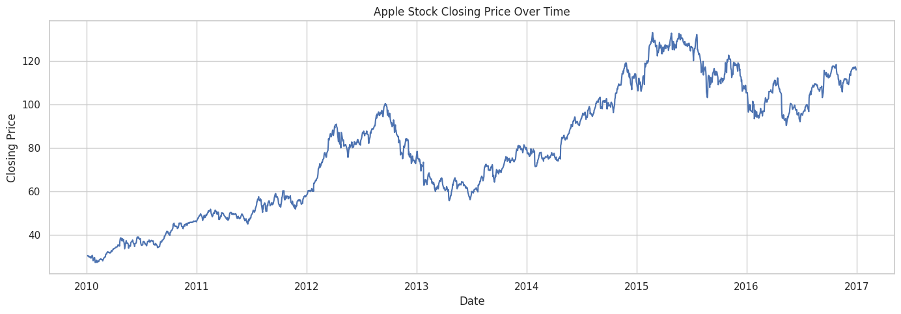

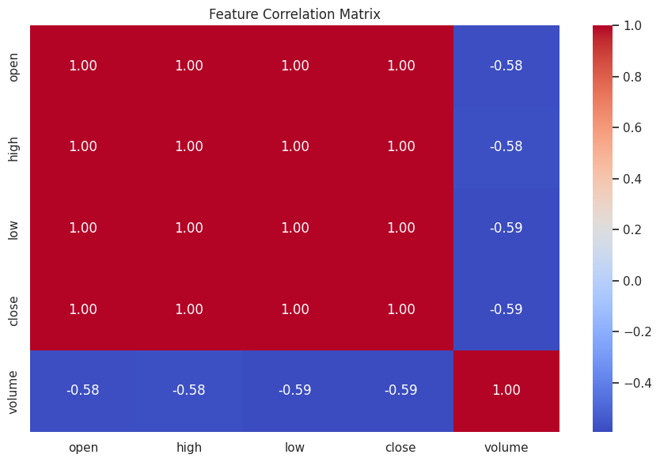

### Modèle et optimisation

Le premier MLP a deux couches cachées de 64 et 32 neurones, avec ReLU, la fonction de perte MSE et l'optimiseur Adam. J'ai ensuite utilisé `GridSearchCV` pour tester plusieurs architectures, taux d'apprentissage, optimiseurs et nombres d'époques.

La meilleure configuration obtenue avec GridSearchCV est : **(32, 16) neurones, Adam, learning rate 0,003 et 30 epochs**.

| Modèle | MAE (test) | RMSE (test) | R² (test) |
|---|---:|---:|---:|
| Naive Baseline | 1,0635 | 1,5043 | 0,9597 |
| MLP initial | 1,4628 | 1,8646 | 0,9381 |
| MLP optimisé | 1,1309 | 1,5880 | 0,9551 |

Le modèle optimisé donne de meilleurs résultats que le premier MLP, mais il ne dépasse pas la méthode naïve qui utilise le prix de clôture actuel pour prédire celui du lendemain.

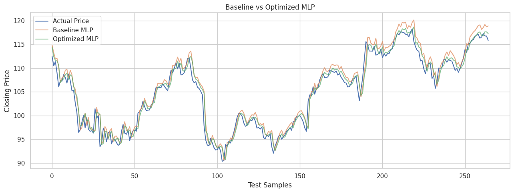

### Courbes et régularisation

Voici les courbes de perte et de précision avec une tolérance de 5 % (`Accuracy@5%`). Cette précision est un indicateur défini pour ce TP ; en régression, les métriques principales restent MAE, RMSE et R².

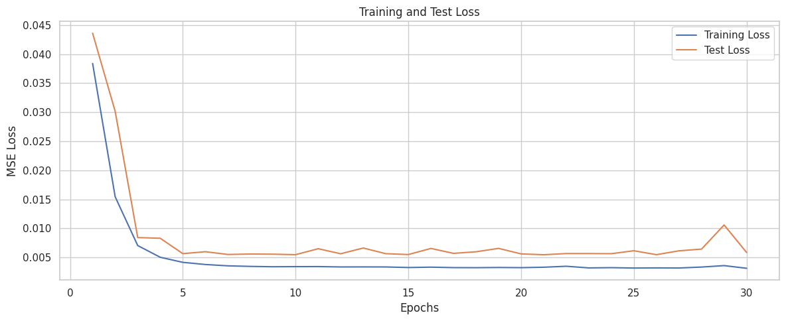

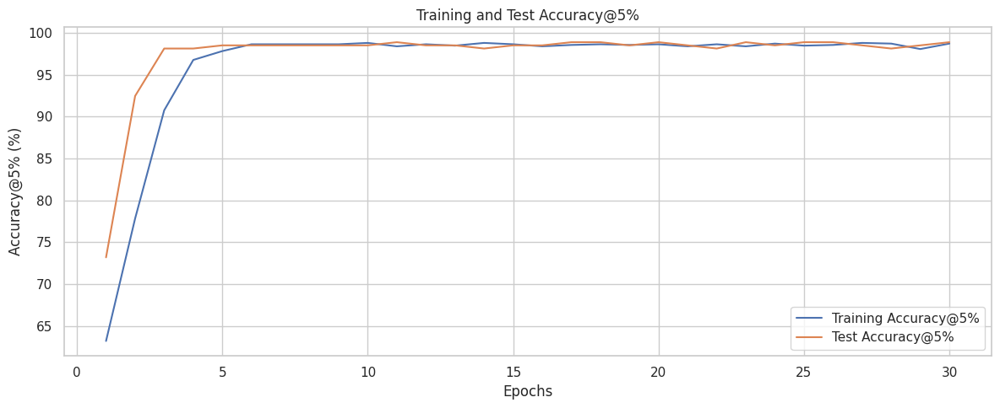

J'ai testé **Dropout**, **L2 Weight Decay** et **Early Stopping**. Ces méthodes changent les résultats, mais aucune configuration testée n'obtient un meilleur RMSE sur le test que le MLP optimisé. Les courbes montrent aussi que la perte de validation ne baisse pas toujours quand l'entraînement continue.

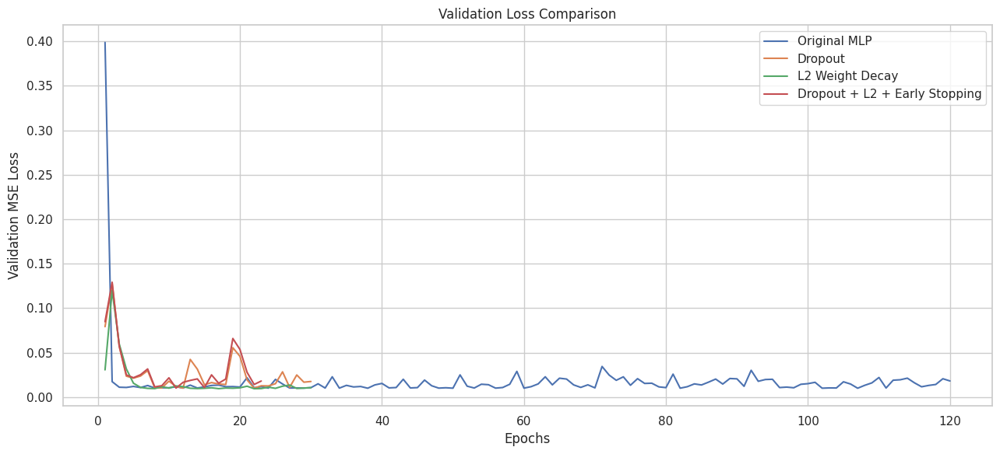

## 2. Classification multiclasse : maintenance prédictive

### Dataset et prétraitement

Cette partie utilise le dataset **Machine Predictive Maintenance**, avec 10 000 observations. Le but est de prédire l'une des **six classes** : `No Failure`, `Heat Dissipation Failure`, `Overstrain Failure`, `Power Failure`, `Random Failures` et `Tool Wear Failure`.

J'ai vérifié les valeurs manquantes et les doublons (aucun dans le dataset), supprimé les identifiants et la colonne `Target` pour éviter une fuite d'information, puis appliqué le label encoding, le one-hot encoding et la standardisation. Les données ont été séparées en 70 % pour l'entraînement, 15 % pour la validation et 15 % pour le test.

Le principal problème est le déséquilibre des classes : **9 652 observations sur 10 000 correspondent à `No Failure`**.

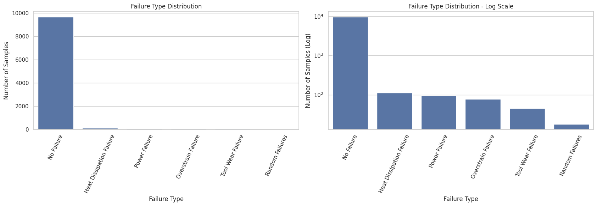

### Data augmentation

Pour traiter ce déséquilibre, j'ai utilisé **SMOTENC** et **RandomUnderSampler** uniquement sur les données d'entraînement. Le jeu d'entraînement obtenu contient **9 000 observations**, avec **1 500 observations par classe**. Les données de validation et de test n'ont pas été équilibrées.

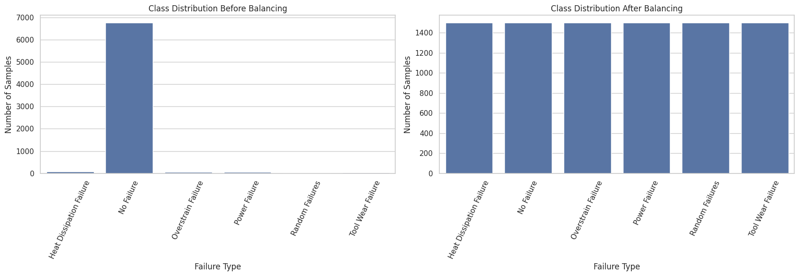

Il faut rester prudent : la classe `Random Failures` ne contenait que 13 exemples dans le train avant le rééchantillonnage. Les observations synthétiques ne remplacent donc pas de nouvelles données réelles.

### Modèles et GridSearchCV

J'ai entraîné un premier MLP avec deux couches cachées (128 et 64 neurones), ReLU, CrossEntropyLoss et Adam. Ensuite, GridSearchCV a testé **16 combinaisons** avec 3 folds, en utilisant le **Macro F1-score** comme critère principal.

Les hyperparamètres retenus sont : **(128, 64) neurones, RMSprop, learning rate 0,003 et 40 epochs**. Pour la recherche, le rééchantillonnage a été appliqué dans les folds de validation croisée, avec 300 observations par classe. Le changement de stratégie d'équilibrage signifie que la différence de résultat ne vient pas uniquement des hyperparamètres.

| Modèle | Accuracy (validation) | Macro F1 (validation) | Balanced Accuracy (validation) |
|---|---:|---:|---:|
| MLP initial | 0,9200 | 0,4895 | 0,5939 |
| MLP optimisé | 0,8273 | 0,4363 | 0,6361 |

Le modèle optimisé améliore la Balanced Accuracy, mais il obtient une Accuracy et un Macro F1 plus faibles.

### Courbes et évaluation

Les courbes montrent une progression sur l'entraînement, mais des variations importantes sur la validation et le test. Cela indique une difficulté à généraliser, surtout pour les classes rares.

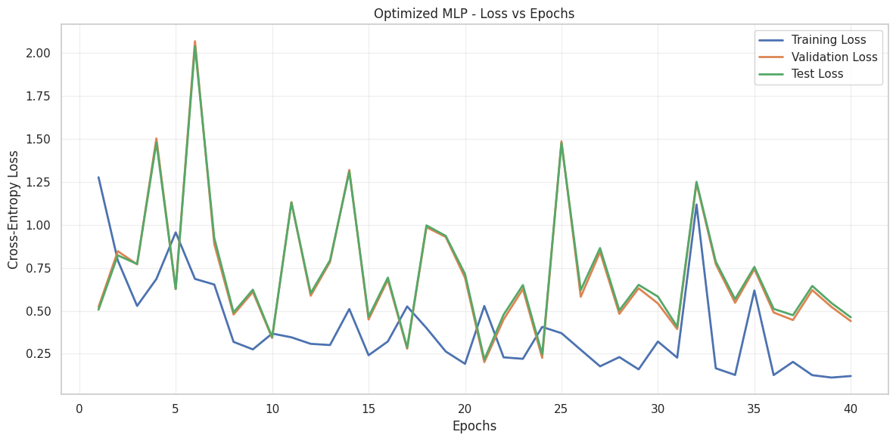

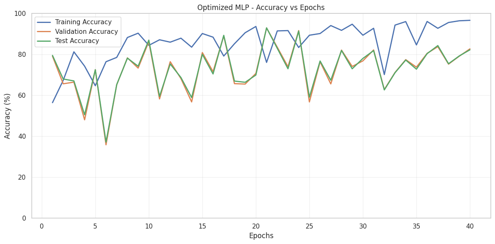

Sur le modèle optimisé, le test donne : **Accuracy = 0,8227**, **Macro Precision = 0,4153**, **Macro Recall = 0,6729** et **Macro F1 = 0,4778**. Le modèle détecte plusieurs types de pannes, mais il n'arrive pas à identifier les deux exemples de `Random Failures` du test, et les prédictions pour `Tool Wear Failure` restent peu précises.

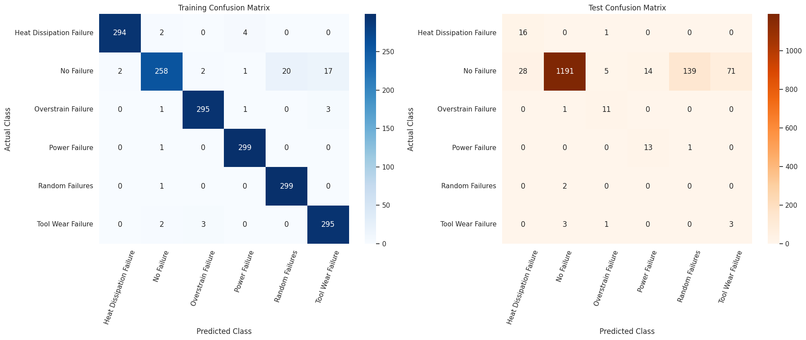

### Tests de régularisation

J'ai essayé **Dropout**, **L2 Weight Decay**, **Early Stopping** et leur combinaison. Sur la validation, le modèle initial reste légèrement meilleur en Macro F1 que les variantes testées. Parmi les configurations de régularisation, Early Stopping est celle qui donne le meilleur Macro F1.

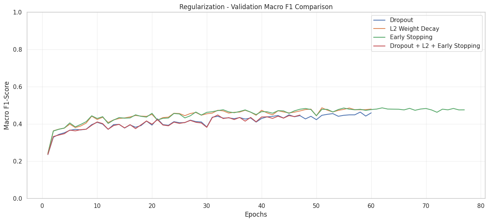

| Modèle | Accuracy (test) | Macro F1 (test) | Balanced Accuracy (test) |
|---|---:|---:|---:|
| MLP initial | 0,9200 | 0,5271 | 0,6640 |
| MLP optimisé | 0,8227 | 0,4778 | 0,6729 |
| Early Stopping | 0,9247 | 0,5348 | 0,6689 |

Early Stopping obtient ici le meilleur Macro F1 sur le test, avec une petite amélioration par rapport au MLP initial. Cela ne change pas le fait que le MLP initial était le meilleur sur la validation selon le critère choisi.

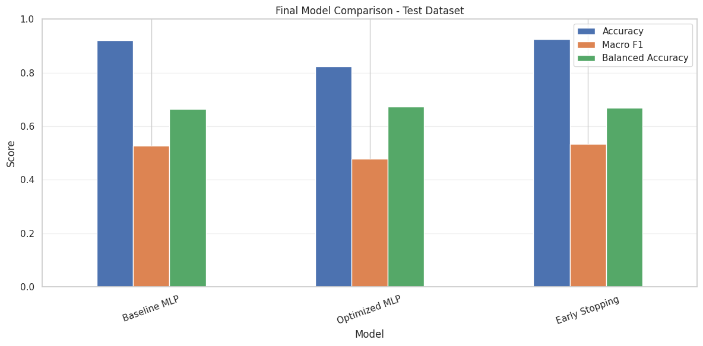

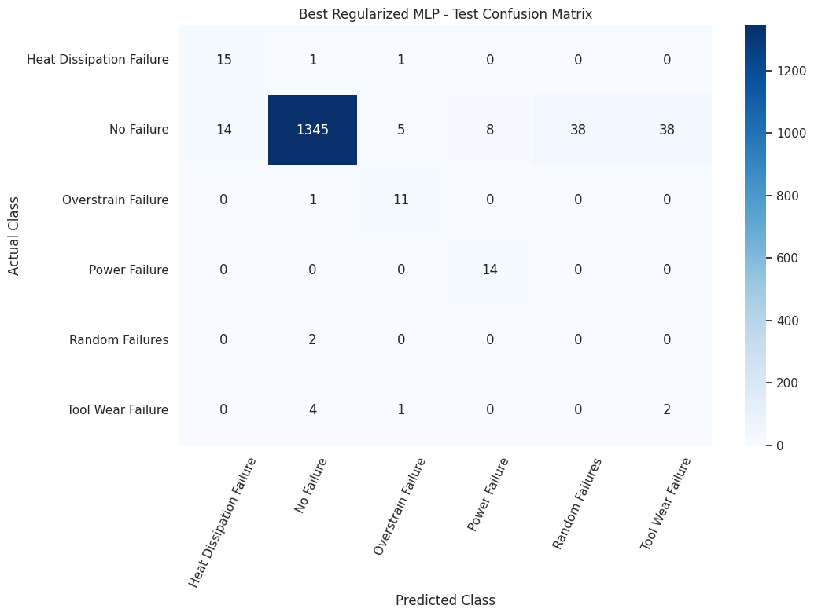

## 3. Synthèse personnelle

Ce TP m'a permis de mieux comprendre comment construire et entraîner un réseau de neurones avec PyTorch. J'ai travaillé sur deux problèmes différents : prévoir une valeur numérique et classer des observations dans plusieurs catégories.

J'ai appris à préparer les données, à utiliser GridSearchCV pour choisir des hyperparamètres et à comparer les modèles avec plusieurs métriques. J'ai surtout remarqué que de bons résultats sur l'entraînement ne suffisent pas. Il faut regarder les résultats sur des données non utilisées pendant l'apprentissage et faire attention aux classes peu représentées.

J'ai également vu qu'un modèle plus complexe ou plus optimisé n'est pas toujours meilleur qu'une méthode simple, et que la régularisation n'améliore pas systématiquement tous les résultats.

## 4. Outils et datasets

- **Environnement :** Kaggle Notebook (Python).
- **Bibliothèques :** PyTorch, Pandas, NumPy, Scikit-learn, Imbalanced-learn, Matplotlib et Seaborn.
- **Régression :** [NYSE Dataset](https://www.kaggle.com/datasets/dgawlik/nyse).
- **Classification :** [Machine Predictive Maintenance Classification](https://www.kaggle.com/datasets/shivamb/machine-predictive-maintenance-classification).

Pour réexécuter le notebook sur Kaggle, il faut ajouter les deux datasets en entrée puis exécuter les cellules dans l'ordre. Les images de ce README proviennent des graphiques générés par le notebook.
